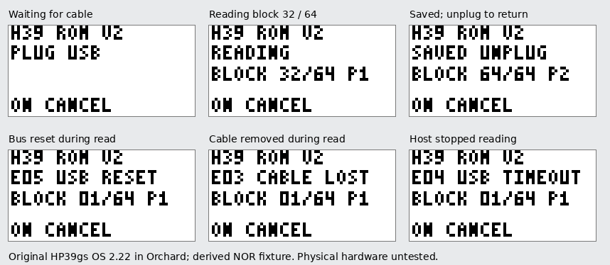

# HP39gs 完整 ROM 采集包 V2

[下载 hp39gs-rom-dump-v2.zip](../downloads/hp39gs-rom-dump-v2.zip) ·
[SHA-256](../downloads/hp39gs-rom-dump-v2.zip.sha256)

V2 包含更新的 **H39 ROM V2** 计算器程序和 Windows 接收器。一次启动读取完整
**1,048,576 字节（1 MiB）物理 NOR**，含前 16 KiB 的 boot 区；每个 16 KiB 块
实际读取两遍，逐字节相同后才接受。计算器显示当前阶段、块号与读数，接收器显示
等待、连接、双读校验和落盘进度。它不需要先运行另一份探针。

用户反馈旧包在 HP39gs 上无进度、无法采集。源码和原厂 OS 执行已经证实旧程序会
关闭 LCD，带线启动时会静默返回，控制端点等待也没有取消边界。V2 修复这些确定的
问题，并重新实现临时映射、进度显示与错误退出。**物理 HP39gs 和 Windows 原生
HID 驱动链路尚未实机验证**；下面明确区分原厂 OS 的模拟执行结果与真机结果。

## 直接使用

包内的 `hp39-rom-receiver.exe` 为 Windows x64 程序，无须安装 Python、Go、
hidapi 或额外 DLL。使用计算器原来的 USB 线。

1. 用已有 Conn3x / HPGCC39 的 **HP 39/40** 方式传入 `calculator/` 目录中的
   四个文件：`HPGCC000.000`、`LIB275L.000`、`HP39DIR.CUR`、`HP39DIR.000`。
   新 aplet 名称必须是 **H39 ROM V2**。旧的 **H39 ROM USB** 不能代替它；
   新接收器会拒绝旧程序。库是包内的 **ARMToolbox39 / Library 275**，与 V1
   的 39 专用库相同，不能用 48/49 的同号库替换。
2. 关闭 Conn3x / HP Connectivity Kit，拔掉 USB。解压后双击
   **`dump-hp39gs.cmd`**，或在解压目录的 PowerShell 运行：

   ```powershell
   .\hp39-rom-receiver.exe -model hp39gs hp39gs-full.bin
   ```

   接收器等待设备时每 5 秒报告一次状态，默认等待两分钟。如需更长准备时间，
   可加 `-wait 5m`；如果已知 VERSION，可加 `-rom-version "C2.22"` 记录版本。
3. 按 APLET，选 **H39 ROM V2**，按 **START**，再按 **ENTER 一次**。
   START 只打开 aplet 页面，ENTER 才执行 ARM 程序。
4. 屏幕显示 **PLUG USB** 后插线。如果启动时已带线，会先显示 **UNPLUG USB**；
   按屏幕提示拔线，再看到 PLUG USB 后重新插入，无须重启计算器。
5. 接收器识别临时 **HP39 ROM Stream V2** HID 设备后自动采集。计算器依次显示
   `READING`、`BLOCK 01/64 P1`、`P2`，直到第 64 块；接收器每块显示
   `two reads equal`，并报告已验证字节数。
6. 等接收器显示 **Dump complete**、计算器显示 **SAVED UNPLUG**，再拔掉 USB。
   程序恢复原时钟、LCD、GPIO、中断和映射后返回原系统，可以按 HOME。交回
   **`hp39gs-full.bin` 与 `hp39gs-full.bin.json`** 即可。

输出文件名已存在时，接收器会明确停止，绝不覆盖原文件。要重复采集，请使用新文件名。
采集中途按 **ON** 可以取消；如果 USB 仍连接，屏幕会保持 `CANCELLED`，
**拔线后才返回原系统**。已经断线的错误会留在屏幕上，按 ON 确认后返回。

本程序只读取 NOR，没有 Flash 编程、擦除或固件更新操作。不要把提取到的 ROM
公开上传到代码仓库。是否备份计算器的日常数据，沿用你的正常使用习惯。

## 屏幕和接收器状态

| 计算器屏幕 | 含义与下一步 |
| --- | --- |
| `UNPLUG USB` | 启动时线已连接。先拔线，等 PLUG USB。 |
| `PLUG USB` | 程序已运行、LCD 保持开启；现在插线。 |
| `ENUMERATING` | 正在完成 USB 枚举。接收器同时显示已等待时间。 |
| `START RECEIVER` | HID 已配置，正在等本包接收器的开始命令。 |
| `READING / BLOCK nn/64 P1/P2` | 正在读指定块；P1、P2 是同一次启动内的两遍独立 NOR 读取。 |
| `HOST SAVING` | 64 块已发送，等接收器将 `.bin` 和 `.json` 同步到磁盘。 |
| `SAVED UNPLUG` | 接收器已发 FINISH；拔线返回原系统。 |
| `CANCELLED` | ON 或接收器取消；拔线返回。 |
| `E01 MEMORY` | ARMToolbox39 没有提供有效的 12 KiB 私有内存。按 ON 返回，确认使用包内 39 专用库并留出内存。 |
| `E02 MMU BUSY` | 所需的两个低地址映射槽已占用。程序未覆盖它们；按 ON 返回。 |
| `E03 CABLE LOST` | 读取中检测到断线。错误处的块号保留；按 ON 返回，重新完整采集。 |
| `E04 USB TIMEOUT` | 主机停止读取超过 15 秒，或枚举/命令等待超过 120 秒。拔线后重新运行接收器和 aplet。 |
| `E05 USB RESET` | 开始读取后 USB 总线复位，或配置被撤销。本轮停止，不把不完整数据当成成功。 |
| `E06 PROTOCOL` | 报告长度、版本或命令顺序不符。确认计算器与接收器都来自 V2 包。 |
| `E07 USB CLOCK` | 无法建立 USB 所需的外设时钟；已恢复原显示时序并保留错误，按 ON 返回。 |

接收器还会区分旧程序、无法读取 HID 描述符、报告长度不符、设备被其他程序占用、
读超时和计算器回传的错误。若一直停在 ENUMERATING，表示主机尚未完成 HID 枚举，
不是已经开始读 ROM。该阶段也可按 ON 取消，不会无限卡在一条控制端点等待中。

## 数据完整性和保存边界

每块都校验报告顺序、物理偏移、长度、32 位字节和与 FNV-1a。第一份有效块到达后，
接收器请求第二次完整 NOR 读取；第二份通过校验，并与第一份 **16,384 个字节全部
相同**后才发送 ACK。校验失败最多重试三次；两份都通过校验但内容不同则直接失败，
不会用继续重读掩盖差异。

64 块及最终 END 汇总全部通过、`.bin` 与 `.json` 均完成落盘后才发送 FINISH。
失败时不会留下本次未完成的输出文件；如果文件已经保存而 FINISH 失败，会明确
报告“files saved but FINISH failed”，已完整保存的数据不会被删除。

这是**一次启动内各块双读**。JSON 的 `independent_block_reads_equal` 和
`read_passes_per_block: 2` 描述的是这一事实。若另做第二次完整采集，可用：

```powershell
.\hp39-rom-receiver.exe -model hp39gs -compare hp39gs-full.bin hp39gs-second.bin
```

正常任务只需交回第一轮完整 `.bin` 与 `.json`，不要求先做短采样或第二轮启动。
JSON 中的机型来自使用者选择，HID 名称不区分 39g+ 与 39gs；收到 1 MiB 文件本身
也不证明机型身份、真实物理映射或可启动性。对应的 `physical_mapping_verified`、
`boot_verified`、`catalog_admitted` 初始仍为 false，留待独立镜像分析确定。

## 这次修复解决了什么

原程序在调整 USB 时钟时关闭 LCD，直到退出才恢复，所以没有可见进度是源码确定的
行为；在带线启动和映射槽不空时也直接返回。旧控制端点代码会等待主机取走 IN 包，
等待中不检查 ON、拔线和新 SETUP。原厂 39gs 2.22 的执行轨迹复现了带线静默返回，
也确认旧程序进入 USB 等待后 LCDEN 为零。[1]

原程序借用 `0x07f00280..0x07f00290` 的五个 L1 表项，它们与原厂 LCD framebuffer
重叠。但本轮原厂 START/ENTER 路径先清了屏，旧入口看到的五个值确实为零，
**这不能被说成用户本次实机失败的已证实原因**。V2 要实时绘制进度，因此改为检查并
借用低地址 L1 槽 `0x11`、`0x12`，六个外设页放进私有、对齐的 1 KiB L2 表，
避免显示写入破坏正在使用的描述符。[1][2]

新程序用 ARMToolbox39 的 12 KiB 分配池容纳 L2 表和 C 栈；先屏蔽 ARM IRQ/FIQ，
再发布临时描述符。虚拟 `0x01100000..0x011fffff` 以无 cache/buffer 的 section
描述符 `0x00000c12` 读取物理 NOR `0x00000000..0x000fffff`。退出清理自有映射，
清除自有 USB/EINT1 中断事件，并恢复原始 CPSR、栈和平台状态。USB 在拔线后交回
原系统，不尝试复活已经结束的 USB 连接。

控制端点改为有状态的非阻塞发送；主循环持续处理新 SETUP、reset、ON 和断线。
IN 数据包写到一半时也检查总线复位，避免 reset 已重置 MAXP/INDEX 后继续按旧配置
填满 FIFO。屏幕始终有进度或明确的退出原因，不能完成的本轮采集会明确停止。

## r19 验证范围

完整执行记录、产物身份、截图 hash 与包重建结果见
[r19 采集与退出验证](evidence/hp39-romstream-r19.json)。



图中为模拟器执行生成的实际 LCD，非真机照片。

- **HP39gs 原厂 OS 2.22 路径**：用官方 2.22 updater 的原始 OS 内容与公开的通用
  50g bootloader 构造私有测试 NOR，正常启动 OS、通过正常 USB 传入新 aplet 和
  39 专用库，再按 START/ENTER 执行。64 块双读与该测试 NOR 的全部 1 MiB
  逐字节相同，FINISH、拔线、HOME 后 `1+1=2` 通过。没有写入客体 RAM 来绕过
  安装、入口或程序执行。**此 fixture 不是真机 39gs 完整 ROM，也不验证其原生 bootloader**。
- **原始 HP39g+ 完整 ROM 路径**：使用此前提供的完整 NOR，正常 USB 安装同一 V2
  程序和库，完成相同的全量双读与返回检查。两条路径返回后均重新打开原厂
  RECV，成功枚举原 `HPx9G+ Device` bulk USB 接口。它是兼容性参照，不代替 39gs 真机结果。
- **39gs 2.22 的退出边界**：带线启动、控制端点主机停止、读中总线复位、读中拔线、
  主机停止读取超时，均显示相应状态并在退出后完成 `1+1=2`。还从真实全量读取的
  END 后 checkpoint 发送错误 FINISH 命令，确认 E06 的错误报告和画面仍指向最后
  完成的第 64 块，并能返回原系统。已核对实际屏幕内容。
- **接收器与分发**：协议负例测试、Windows/Linux Go vet、ZIP 来源/二进制/权限检查
  与离线源码重建均固定在证据中；Windows PE 实际设备 I/O 仍待真机链路验证。

全量读取、退出边界及后续复核使用的精确 WASM 和源文件身份，分别记入上述
证据。安装 checkpoint 来自本轮先前构建的正常 USB 安装；没有把安装后的 checkpoint
回放说成在每个后续构建中重新安装。

物理 HP39gs 的特定硬件、USB 线和 Windows 驱动组合仍是剩余未知。用户此前“无进度、
不能 dump”的反馈是真机事实，本页的原厂 OS 模拟执行不能覆盖或否定该反馈。
V2 是可直接完成全量采集的修订程序；不再把旧 39g+ payload 原样重打包当作修复。

V1 仅保留为历史记录：[r17 完整读出](evidence/hp39-romstream-r17.json)、
[r18 独立复核](evidence/hp39-romstream-revalidation-r18.json)。其中的旧包 hash 和
旧验证范围没有改写为 V2 的结果。

## 来源、离线重建与许可证

| 项目 | 固定身份 |
| --- | --- |
| 原始 hpclang 基础 | `e240c58c2e9dd3ac4d18002ed9a93d2c7cc67900` |
| V2 ARM payload | 9,364 字节，SHA-256 `71e93a0b334c41537d7e36a7d9b76397294d900095fa2137f76056ba8f08a83e` |
| V2 HPGCC000.000 | 10,344 字节，SHA-256 `298732caeba57a240acf135f1260c6f1cf1899e024fb734f3b4d2c4f92cadcc1` |
| 39 专用 LIB275L.000 | 1,489 字节，SHA-256 `88b0d556ae86784dc0e3ede7f53a45ece12d2513128b4fc96b9655bf881dcdd1` |
| HP-GCC39 SDK | `7fa1503912338ea0fdf1d39eb584770f4d121cd2` |
| ARM 编译器 | Arm Toolchain for Embedded 22.1.0 |

包内提供 V2 C/汇编/包装源码、完整原 aplet 模板和库源码、接收器、固定输入 hash、
构建器与许可证。hpclang 原创 ARM/接收器代码和 Orchard 修改保留 MIT；结合
HP-GCC39 模板的 aplet 与 Library 275 按 GPLv2+ 分发。第三方计算器代码不进入
模拟器 C/WASM 核心。包内没有 HP ROM、bootloader、安装后 checkpoint 或用户镜像。

在准备好 ATfE 22.1.0、HPTools 3.0.8（作者 64 位补丁）、Go 1.22.2 和本地 C
编译器的环境中，从解压目录完全离线重建：

```sh
python3 tools/package-hp39-romstream.py build \
  --atfe /path/to/atfe --hptools /path/to/hptools/bin \
  --go /path/to/go /new/hp39gs-rom-dump-v2.zip
python3 tools/package-hp39-romstream.py verify /new/hp39gs-rom-dump-v2.zip
```

构建器从源码重建 ARM payload、GPL 模板、39 专用库和最终 aplet，核对固定 hash。
使用相同工具版本可得到逐字节相同的完整 ZIP；Go 补丁版本不同可能改变 Windows PE，
实际编译器与产物身份会记入清单。包自身的 hash 使用独立
[校验文件](../downloads/hp39gs-rom-dump-v2.zip.sha256)，不把 ZIP 的 hash 写进其自身 README。

### 一级资料

1. [hpclang 固定基础源码](https://github.com/maxmixalex/hpclang/tree/e240c58c2e9dd3ac4d18002ed9a93d2c7cc67900/research/hp39gplus)，包含原 streamer、入口、包装器和使用说明；V2 源码在包内 `tools/hp39-romstream/calculator/`。
2. [HP-GCC39 固定 SDK](https://github.com/lobakkang/patched-hpgcc-1.1-sdk-for-hp39gs/tree/7fa1503912338ea0fdf1d39eb584770f4d121cd2/sources/HP39-Aplet)，包含原 applet skeleton、hp2aplet 和 39 专用 LIB275。
3. [HP39gs 原厂 2.22 更新包](https://www.hpcalc.org/details/7098)，本轮原厂 OS 执行 fixture 的 OS 来源；更新包不是完整 boot NOR。
4. [Arm 官方 ATfE 22.1.0](https://github.com/arm/arm-toolchain/releases/tag/release-22.1.0-ATfE)。Linux x86_64 编译器包 SHA-256：`e2e9e637bba097ba6e4bae6982883fe705ffd7e8c3a7dc876964835ef1c7a724`。
5. [HPTools 3.0.8 源包](https://www.hpcalc.org/hp48/pc/programming/hptools-src-3.0.8.tar.gz)与 [Paul Onions 64 位补丁](https://pdo.github.io/hptools/hptools-pdo-20190426.patch)。工具本身为外部依赖，不随采集包分发。
